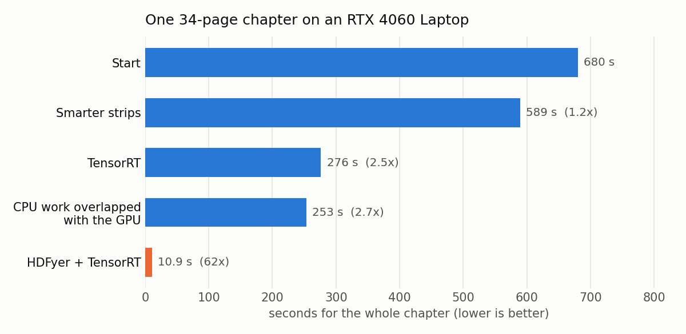
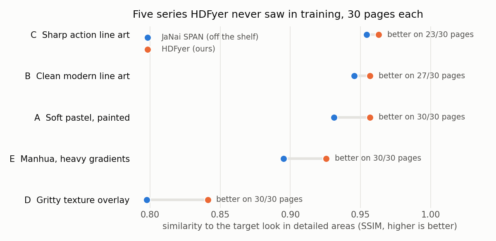
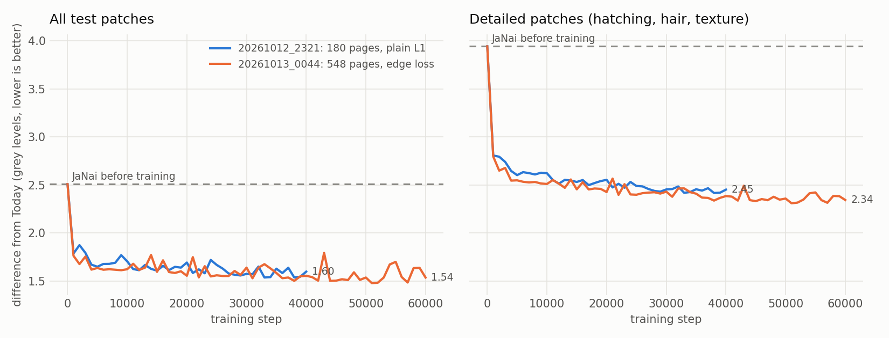

# ManwhaHDFyer

ManwhaHDFyer takes the low-resolution, heavily compressed manhwa (Korean webtoon) chapters that reader apps download as CBZ files and turns them into sharp 2× versions you can read on a tablet without squinting. It runs locally on an NVIDIA GPU, chapter by chapter, and writes new CBZ files next to the old ones. I built it from scratch to learn ML inference, GPU performance work and model training end to end.

**Headline:** one 34-page chapter went from **680 s to 10.9 s** on an RTX 4060 laptop GPU, **62× faster**. Most of that comes from HDFyer, a small 2× model I distilled myself. Distilling means training a small model to copy a big one. On 150 pages from five series it never saw in training, HDFyer stayed closer to the look it was trained to copy than the off-the-shelf JaNai SPAN model did on 140 of the 150 pages, measured in the detailed areas of each page.

---

## Results

### Speed



Each bar is the wall-clock time for the same chapter (one 34-page chapter, 800 px wide) on the same laptop. Every time includes reading the CBZ, upscaling, sharpening, JPEG encoding and writing the output. Each step was measured once, on different days, so treat small differences as noise.

| Step | What changed | Chapter time |
|---|---|---|
| Start | 4x-UltraSharp in plain PyTorch, tallest strips that fit in memory, 128-row overlaps | 680 s |
| Smarter strips | One strip shape per page and 32-row overlaps, so less work is done twice | 589 s |
| TensorRT | NVIDIA's optimising runtime compiles the model for this GPU (2.6× faster model) | 276 s |
| CPU overlap | Sharpening and JPEG encoding run on background threads while the GPU works | 253 s |
| HDFyer + TensorRT | Our own small 2× model replaces 4x-UltraSharp | **10.9 s** |

The first four steps sped up the pipeline around 4x-UltraSharp, the model HDFyer was later distilled from. The last step swaps the model itself: on this laptop HDFyer is about 22× faster than 4x-UltraSharp per page, because it is far smaller and draws the 2× image directly instead of drawing at 4× and shrinking the result.

### Quality

HDFyer was trained to reproduce the look of the old pipeline: 4x-UltraSharp's output, shrunk to 2×, before sharpening. That output is the "target look" below. Quality is measured as SSIM (structural similarity: 1.0 means identical structure) between each model's output and the target. It is measured over the detailed areas of each page (hatching, hair, texture), where upscalers differ most. Flat colour and blank gutters look the same from any decent model.



The exam used five series HDFyer never saw in training, 30 random pages each. HDFyer was closer to the target than JaNai SPAN on 140 of the 150 pages, and on every page in three of the five series. JaNai SPAN is the public model HDFyer started from. What this measures is faithfulness to the look I chose, not absolute image quality. It shows the distillation worked and generalises beyond the training series.



Training curves for the two training runs. The y-axis is the average difference from the target look ("Today" in the chart) on held-out test patches, in grey levels out of 255. The dashed line is JaNai SPAN before any training. Run 2 (orange: more pages and a loss that also rewards sharp edges) is the model in use. Details are in the [model card](models/hdfyer/README.md) and [experiments/exp16/](experiments/exp16/).

---

## How it works

```
CBZ → decode pages
    → cut each page into fixed 512-row strips
    → group same-shape strips into batches → HDFyer 2× on the GPU (TensorRT, FP16)
    → stitch each page back together, blending the overlaps
    → (background threads) sharpen → clean up near-black → JPEG
    → output CBZ, written as .part and renamed when the chapter is complete
```

**Strip planner** (`inference/chunker.py`). A manhwa page is typically 700–1080 px wide and 3000–9000 px tall, too big to upscale in one go. Every page is cut into strips of exactly 512 rows. Strips step down the page with 32 rows of overlap, so each seam has context on both sides. The last strip is anchored to the bottom of the page: it overlaps its neighbour by more than 32 rows, and the extra rows are thrown away after upscaling. A page shorter than 512 rows is padded to a full strip by reflecting it downwards, and the reflection is cropped off afterwards. After upscaling, each 32-row overlap is cross-faded from one strip to the next, which hides the seams. Stitched strips differ from upscaling the same area in one pass by at most 2 grey levels, and only near the seams. Because every strip of a given page width has exactly the same shape, one compiled engine per width covers everything.

**HDFyer** (`core/model_loader.py`, [model card](models/hdfyer/README.md)). HDFyer is a SPAN-S network of about 2 million parameters. SPAN is a lightweight super-resolution architecture. It started from the public JaNai SPAN weights and was then trained on 548 manhwa pages to copy the output of 4x-UltraSharp, a much larger model with a look I like. The training run behind the current model cost about $6 of rented GPU time (two runs, about $10 in total); the training code is in [experiments/exp16/](experiments/exp16/). SPAN merges some of its layers when it is switched from training to inference. The library I load it with redoes that merge on every pass, so I merge once at load time.

**TensorRT engines** (`inference/trt_backend.py`). TensorRT is NVIDIA's runtime that compiles a model into an "engine" tuned for one GPU and one input shape. Engines use FP16 (half-precision numbers, faster on modern GPUs). Their output differs from plain PyTorch by at most 9 grey levels on any pixel, and by under 0.2 on average, across 184 test pages. An engine is built the first time a page width is seen; a 1080 px width took 51 s on the laptop. Engines are cached in `cache/trt_engines/`. The file name records the input shape, batch size, a hash of the model weights, the GPU and the TensorRT version, so a changed model or a different machine always gets a fresh build. One HDFyer strip takes about 18 ms through TensorRT on the laptop, against 58 ms in plain PyTorch.

**Batch size from the profiler** (`profiler/hdfyer.py`). Several strips can go through the model in one pass (a batch). The first time the program sees a page width on a GPU, it times batch sizes 1, 2, 4 and 8. It stops before a batch would use more than 75% of the GPU's memory, and stores the best one in `cache/<gpu>.json`. A larger batch has to be at least 3% faster per strip to be chosen. On the RTX 4060 laptop every batch size takes the same time per strip, so it picks 1. On a large datacenter GPU it can pick more.

**CPU overlap** (`pipeline/finisher.py`). Once a page is stitched, it is sharpened (a gentle unsharp mask), near-black pixels are set to pure black (this removes blotchy noise in dark areas), and it is JPEG-encoded. These run on a pool of background threads while the GPU carries on with the next pages. Only the main thread writes to the CBZ, in the order pages come off the GPU, and the output is byte-identical to doing it all on one thread. The CBZ itself is reproducible: the same input gives the same file byte for byte.

**Loud fallbacks** (`inference/engine.py`). If an engine cannot be built or fails while running, that strip shape falls back to plain PyTorch for the rest of the run. If the GPU runs out of memory, the program frees the failed engine and its memory and retries with a smaller batch. Every one of these events is printed when it happens, as a `!!! FALLBACK:` line naming the chapter, the pages, the strip shape and the reason. All of them are listed again in a summary at the end of the run. A clean run ends with "Fallbacks: none."

### Code layout

```
main.py                    entry point: loads HDFyer, processes every chapter in Manwhas/
core/                      CBZ reading, model loading, CBZ writing
inference/chunker.py       strip planner
inference/batcher.py       groups same-shape strips into batches
inference/engine.py        pre/post-processing, backend choice, fallbacks and out-of-memory recovery
inference/trt_backend.py   TensorRT engine build, cache and run
profiler/hdfyer.py         best batch size per GPU and page width
pipeline/                  per-page strip collection, stitching, background finishing
postprocessing/            sharpening and black cleanup
experiments/               numbered experiments behind every change above (see experiments/README.md)
test.py                    tests that need no model: stitching, fallbacks, recovery, finishing
```

---

## Known limitations

- **HDFyer smooths film grain and paper texture.** It was trained to minimise the average pixel difference from the target. That rewards a safe average where the target has fine random grain, so grain comes out softer than in the target. The next training run changes the training objective to address this.
- **The first time a page width is seen costs an engine build** (about a minute on the laptop) plus a few seconds of batch profiling. Both are cached, so it happens once per width per GPU, but a library with many unusual widths pays it several times.
- **NVIDIA GPU required.** There is no CPU mode. TensorRT is optional; without it the same model runs in plain PyTorch, about 2.3× slower per chapter.
- **Paths are hard-coded** in `main.py` (`Manwhas/` in, `results/` out).

---

## Requirements

- Python 3.10+ (developed on 3.12)
- An NVIDIA GPU with CUDA. Developed on an 8 GB RTX 4060 Laptop; at batch 1 HDFyer needs about 0.8 GB of GPU memory for 800 px wide pages and 1.8 GB for 1500 px.
- Optional, recommended: TensorRT (`tensorrt-cu12`) and `onnx`, for the fast path.

## Setup

```bash
git clone https://github.com/Sidrawat11/manwha-hdfyer.git
cd manwha-hdfyer
python -m venv venv
source venv/bin/activate          # Windows: venv\Scripts\activate
```

Install PyTorch with CUDA first. pip's default index ships CPU-only builds, so use the PyTorch CUDA index (pick your CUDA version on [pytorch.org](https://pytorch.org/get-started/locally/)):

```bash
pip install torch==2.10.0 torchvision==0.25.0 --index-url https://download.pytorch.org/whl/cu128
pip install -r requirements.txt
pip install tensorrt-cu12==11.4.0.106 onnx==1.23.2   # optional, recommended
```

Put the HDFyer weights at `models/hdfyer/hdfyer-2x-s-r2.pth`. They are not in the repository; see the [model card](models/hdfyer/README.md).

The experiments that run 4x-UltraSharp also need `models/4x-UltraSharp.pth` from [OpenModelDB](https://openmodeldb.info/models/4x-UltraSharp). They also need a one-line fix to `basicsr` if importing it fails with `No module named 'torchvision.transforms.functional_tensor'`: in `site-packages/basicsr/data/degradations.py`, change `torchvision.transforms.functional_tensor` to `torchvision.transforms.functional`. The main program does not need either.

## Usage

Put your chapters in `Manwhas/` (any folder structure; every `*.cbz` is found), then:

```bash
python main.py
```

Output goes to `results/`, mirroring the input folders. Chapters already done are skipped, so an interrupted run picks up where it stopped.

| Flag | Default | What it does |
|---|---|---|
| `--backend auto\|trt\|compiled\|eager` | `auto` | Inference runtime. `auto` is TensorRT if installed, else plain PyTorch (`eager`). |
| `--weights PATH` | `models/hdfyer/hdfyer-2x-s-r2.pth` | HDFyer weights. |
| `--batch auto\|N` | `auto` | Strips per forward pass. `auto` uses the profiled best batch for this GPU and page width; a number overrides it. |
| `--cpu-workers N` | `min(4, CPU count)` | Background threads for sharpening and JPEG encoding. |
| `--max-inflight N` | `3` | Most finished pages waiting for those threads at once (about 45 MB each). |
| `--no-overlap` | off | Do the sharpening and encoding on the main thread, for debugging and comparison. |
| `--parallel N` | `1` | Chapters processed at once, each in its own worker process with its own copy of the model. For large GPUs (16 GB+), where one Python process can't keep the GPU busy; on a laptop it gains little. A warm-up builds every engine and batch profile first, so the workers never write the caches. |

Run the tests (no model needed, a few minutes):

```bash
python test.py
```

---

## Project history

- **Phase 0, MVP.** A 180-line script around Real-ESRGAN: 33 minutes per chapter, 580 MB of temporary files, and a stitching bug that doubled panels.
- **Phase 1, modular rewrite.** Streaming CBZ-to-CBZ processing with no temporary files, blended seams, FP16, sharpening and resume support.
- **Phase 2, custom engine.** Replaced Real-ESRGAN with my own inference code, a GPU memory profiler and batching.
- **Phase 3, speed.** A series of measured experiments ([experiments/](experiments/)): smarter strips, TensorRT, CPU overlap. Then HDFyer, distilled from 4x-UltraSharp, became the only model the pipeline runs.

## Roadmap

- [ ] Training run 3: an objective that keeps film grain and paper texture
- [ ] Command-line paths and output format/quality
- [ ] Skip credit pages
- [ ] Full library run on a datacenter GPU
- [ ] Desktop comparer with a slider and synced zoom
- [ ] Real-time integration with a reader app (Mihon, via a Suwayomi-based proxy)

## License

MIT
